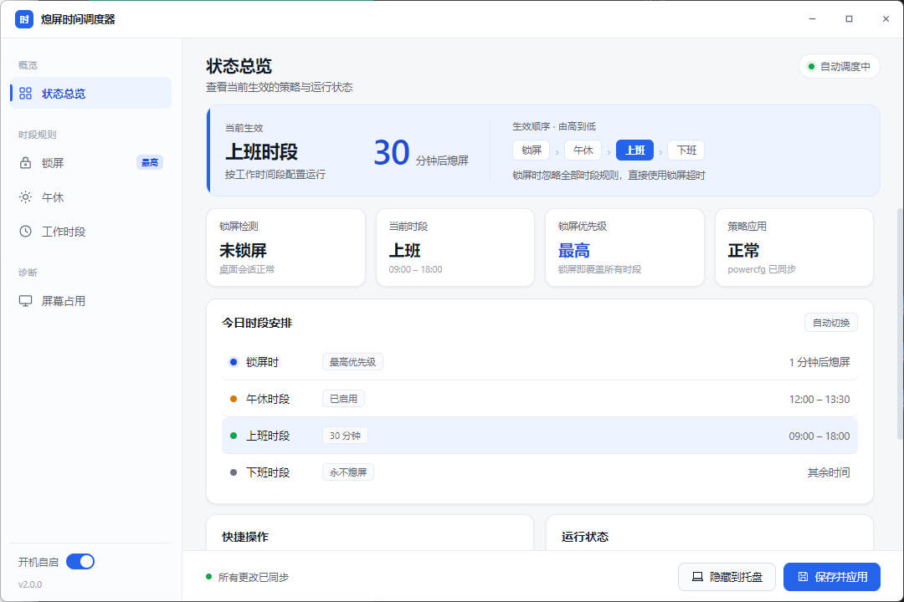

# Screen Timeout Scheduler

[简体中文](README.md) · English


A Windows and macOS desktop utility that automatically adjusts the display-off timeout based on the time of day. When the session is locked it immediately switches to a dedicated policy, then restores the previous one on unlock. Runs in the system tray or macOS menu bar.

> This is **2.0**, a full rewrite in Electron (both UI and backend), replacing the earlier Python / Tk version.

## Why

The system display-off timeout cannot follow your schedule by itself: you may want a longer delay while working and a shorter one during lunch or after hours. This app switches automatically between **lock / lunch / work / off** states using `powercfg` on Windows and `pmset` on macOS.

## Features

- **Lock screen has the highest priority**: once the session is locked, all time-based rules are ignored
- **Four independent timeouts**: lock, lunch, work, and off-hours; `0` means never turn off
- **Modern UI**: custom title bar, sidebar navigation, status hero card, paged settings, fixed action bar
- **Live status**: the first screen shows the active mode, a large timeout number, and a highlighted priority chain
- **Lock notifications**: system notifications on lock / unlock; lock-screen visibility depends on system settings
- **Display request inspector**: shows Windows power requests or macOS power assertions and lets you end listed processes
- **System tray / single instance / launch at login**
- **Automatic config migration**: imports legacy Python settings on first run on Windows

## macOS version

Targets macOS 13+ on Intel and Apple Silicon. The UI matches the Windows version. A privileged background service runs `pmset -a displaysleep` for both AC and battery power. The macOS version currently consists of source code and a build workflow; no installation package has passed real-device acceptance yet.

### Install and authorize

For a formally signed `.dmg`, drag the app into Applications and launch it. Follow the in-app prompt to approve its background service under System Settings → General → Login Items. Then click “Reapply now” or wait for the next scheduled check. If you enable launch at login, confirm that login item is enabled too. The status header and application card show a failure when the system setting could not be applied. Lock-screen notifications follow macOS notification preferences.

The privileged service accepts only display-off timeouts from `0` to `999` minutes from an app signed by the same developer. It does not execute arbitrary commands. Closing the app does not restore the previous system display timeout.

### Build

On a Mac with Node.js 18+ and Xcode Command Line Tools:

```bash
npm ci
npm test
npm run dist:mac
```

Distribution requires a Developer ID Application certificate and Apple notarization credentials. Supply them through electron-builder environment variables such as `CSC_LINK`, `CSC_KEY_PASSWORD`, and `APPLE_API_KEY`; do not commit credentials. The universal `.dmg` is written under `dist/`. Run `MAC_UNSIGNED=1 npm run dist:mac` to check compilation and packaging only: an ad-hoc signature has no developer Team ID, so the background service rejects policy calls from that build. The macOS GitHub Actions job checks the native tool, service plist, and universal app structure this way.

Real-device verification of service approval, lock / unlock, AC / battery changes, power assertions, and launch at login remains necessary before release.

## Interface



| Area | Contents |
|---|---|
| Sidebar | Status overview, lock, lunch, work hours, display requests; launch-at-login switch at the bottom |
| Hero card | Active mode, timeout in minutes, and the `Lock › Lunch › Work › Off` priority chain |
| Content | Paged by navigation, 1–2 cards per page; sliders, number inputs, time pickers, switches |
| Action bar | Hide to tray, Save and apply (with an unsaved-changes indicator) |

The lock state gets its own navigation page with a "highest" badge and sits first in the priority chain — hierarchy is expressed through layout rather than a line of explanatory text.

## Priority

| Priority | State | Condition | Setting |
|---|---|---|---|
| 1 (highest) | Lock | The desktop session is locked | `lock_timeout` |
| 2 | Lunch | Enabled **and** inside work hours **and** inside the lunch window | `lunch_timeout` |
| 3 | Work | Inside work hours | `work_timeout` |
| 4 | Off | Any other time | `off_timeout` |

Lunch only applies when it falls inside both the work-hours window and the lunch window, so a lunch range accidentally placed outside working hours cannot interfere with the off-hours policy.

## Getting started

### Run the binary

Download `dist/ScreenTimeoutScheduler.exe` from this repository (portable single file for Windows 10/11 x64, no installation needed) and double-click it. It corresponds to tag `v2.0.0`.

### Run from source

The Windows version requires Windows and Node.js 18 or newer.

```bash
npm install     # the prepare step generates icon assets
npm start
```

### Build

```bash
npm run dist
```

Output: `dist/ScreenTimeoutScheduler.exe` (electron-builder portable).

## Configuration

Stored at `%APPDATA%\screen-timeout-scheduler\config.json` on Windows or `~/Library/Application Support/screen-timeout-scheduler/config.json` on macOS; you can also edit it in the UI and click "Save and apply".

| Key | Default | Description |
|---|---|---|
| `work_start` | `09:00` | Work start |
| `work_end` | `18:00` | Work end |
| `work_timeout` | `30` | Display-off timeout during work (minutes) |
| `off_timeout` | `3` | Display-off timeout off-hours (minutes) |
| `lunch_enabled` | `true` | Enable the lunch period |
| `lunch_start` | `12:00` | Lunch start |
| `lunch_end` | `13:00` | Lunch end |
| `lunch_timeout` | `30` | Display-off timeout during lunch (minutes) |
| `lock_timeout` | `1` | Display-off timeout while locked (minutes) |
| `notify_on_lock` | `true` | Notify on lock / unlock |
| `auto_start` | `false` | Launch at login |

A timeout of `0` means never turn off the display. On first run, a legacy Python config at
`%APPDATA%\ScreenTimeoutScheduler\config.json` is migrated automatically.

## How it works

- **Scheduling**: checks every 20 seconds; Windows applies `powercfg /change monitor-timeout-ac|dc`, while the macOS helper applies `pmset -a displaysleep`.
- **Lock detection**: Electron `powerMonitor` lock / unlock events are the primary signal. Windows polls `LogonUI.exe` and macOS checks the system lock state every 3 seconds as a fallback.
- **Notifications**: both platforms use Electron `Notification`. Windows also adjusts notification registry settings and delays lock notifications by 2 seconds; macOS follows its notification preferences.
- **Tray and lifecycle**: the tray or menu bar icon color follows the active mode; `app.requestSingleInstanceLock()` enforces a single instance; `setLoginItemSettings` manages launch at login; closing the window hides it.
- **Display requests**: Windows parses `powercfg /requests` and uses `tasklist` / `taskkill`. macOS reads display sleep blocking assertions through IOKit and rechecks PIDs before terminating a process. Both protect critical system processes and the app itself.

## Project layout

```
.
├── docs/
│   └── preview.png       # UI screenshot
├── scripts/
│   ├── gen-icons.js      # Generates tray PNGs, ICO, and macOS icon source
│   └── build-mac.sh      # Builds the universal helper and app on macOS
├── mac/                  # Privileged helper source and launch daemon plist
├── src/
│   ├── main.js           # Main process: scheduling, lock detection, tray, notifications, IPC
│   ├── config.js         # Configuration validation and persistence
│   ├── scheduler.js      # Shared schedule priority rules
│   ├── platform-mac.js   # macOS system adapter
│   ├── preload.js        # contextBridge security layer
│   ├── index.html        # UI structure
│   ├── styles.css        # Styles and responsive layout
│   ├── renderer.js       # Interactions and state rendering
│   └── icons/            # Generated tray icons (not committed)
├── build/icon.ico        # Generated build icon (not committed)
├── tests/                # Configuration and scheduling tests
├── dist/                 # Build artifacts
├── package.json
└── package-lock.json
```

## FAQ

**I don't see a notification after locking.**
Windows needs 1–2 seconds to switch to the secure desktop; the app already waits 2 seconds. When testing, stay on the lock screen for at least 10 seconds. If the card only says "Private", check the system setting that hides notification content on the lock screen.

**Why is the exe over 70 MB?**
The portable Electron binary bundles the Chromium runtime. It exceeds GitHub's recommended 50 MB, so future builds should be published as Release assets instead of committed to git history.

**Icons are missing after cloning.**
They are generated by `scripts/gen-icons.js` during the `prepare` step of `npm install`; only the generator is committed so builds stay reproducible. You can also run `npm run icons` manually.

## Limitations

- The macOS helper requires a signed app and initial system approval; real-device verification is still pending.
- Lock detection uses Electron events plus a LogonUI fallback, which differs from the legacy Python `OpenInputDesktop` approach and **has not yet been fully verified against a real `Win+L` session**.
- Windows changes the active power plan's display timeout; macOS changes `displaysleep` for every power source. Neither changes system sleep or hibernation settings.

## Repository

https://github.com/whenjun/screen-timeout-scheduler
