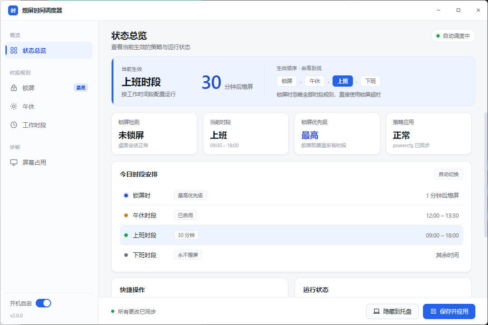

# 熄屏时间调度器

[English](README.en.md) · 简体中文


按时段自动调整 Windows 或 macOS 屏幕熄屏超时的桌面小工具。锁屏时立即切换到独立策略，解锁后自动恢复，常驻系统托盘或 macOS 菜单栏。

> 当前为 **2.0**，使用 Electron 全量重写（界面与后端均为新实现），取代早期的 Python / Tk 版本。

## 为什么需要它

系统的「关闭显示器」超时无法随作息变化：上班时希望屏幕多亮一会儿，午休或下班后希望尽快熄屏，锁屏后更该尽快关屏。本程序按 **锁屏 / 午休 / 上班 / 下班** 四种状态自动切换超时，不需要人工干预。

## 特性

- **锁屏拥有最高优先级**：会话一旦锁定，立即忽略所有时段规则
- **四套独立超时**：锁屏、午休、上班、下班分别配置，`0` 表示永不熄屏
- **现代界面**：自绘标题栏 + 左侧导航 + 状态总览 Hero 卡 + 分页设置 + 固定操作栏
- **实时状态**：首屏显示当前生效模式、大号熄屏分钟数，以及高亮的生效优先级链
- **锁屏通知**：锁屏 / 解锁时推送系统通知；能否显示在锁屏界面取决于系统通知设置
- **屏幕占用检测**：Windows 读取 `powercfg /requests`，macOS 读取电源断言，支持结束列出的进程
- **托盘常驻 / 单实例 / 开机自启**
- **配置自动迁移**：Windows 首次运行自动读取 Python 旧版配置

## macOS 版

目标系统为 macOS 13 及以上的 Intel、Apple 芯片。界面与 Windows 版保持一致；系统设置由受权后台服务执行 `pmset -a displaysleep`，同时覆盖交流电和电池供电。macOS 版目前只有源码及构建流程，尚无经过真机验收的安装包。

### 安装与首次授权

正式构建的 `.dmg` 中，将应用拖入「应用程序」后启动。首次启动时，按界面提示到「系统设置 → 通用 → 登录项」批准后台服务，再点击「立即重新应用」或等待下一次自动检查。若开启「开机自启」，也应检查登录项是否已启用。策略应用失败时，顶部状态和「策略应用」卡片会显示失败；通知是否出现在锁屏界面由 macOS 通知设置决定。

后台服务需要同一开发者签名的应用调用。它只接受 `0–999` 分钟的显示器熄屏时间，不执行来自界面的任意命令。退出应用后，已写入的系统熄屏设置不会自动恢复。

### 构建

在 Mac 上安装 Node.js 18+ 与 Xcode Command Line Tools 后构建：

```bash
npm ci
npm test
npm run dist:mac
```

正式分发构建需要 Developer ID Application 证书及 Apple 公证凭据，可通过 electron-builder 支持的 `CSC_LINK`、`CSC_KEY_PASSWORD` 和 `APPLE_API_KEY` 等环境变量提供，不要写入仓库。产物是 `dist/` 下的双架构 `.dmg`。只检查编译和打包时可运行 `MAC_UNSIGNED=1 npm run dist:mac`；临时签名没有开发者 Team ID，后台服务不会接受它的策略调用。GitHub Actions 的 macOS 构建任务使用此模式检查原生工具、服务配置和双架构应用结构。

本仓库尚未在 Mac 真机验证后台服务授权、锁屏 / 解锁、电池 / 交流电切换、占用检测和登录自启；正式发布前须逐项验收。

## 界面



| 区域 | 内容 |
|---|---|
| 左侧导航 | 状态总览、锁屏、午休、工作时段、屏幕占用；底部开机自启开关 |
| 顶部 Hero 卡 | 当前生效模式、熄屏倒计时分钟数、`锁屏 › 午休 › 上班 › 下班` 优先级链 |
| 内容区 | 按导航分页，每页只有 1~2 张卡片；滑块、数字输入、时间选择、开关 |
| 底部操作栏 | 隐藏到托盘、保存并应用（有未保存更改时提示） |

锁屏状态在导航里单独成页、带「最高」徽章，并在优先级链中排第一——层级关系由布局表达，而不是靠一行文字说明。

## 生效优先级

| 优先级 | 状态 | 判定条件 | 使用配置 |
|---|---|---|---|
| 1（最高） | 锁屏 | 桌面会话已锁定 | `lock_timeout` |
| 2 | 午休 | 已启用 **且** 落在上班时段内 **且** 落在午休窗口内 | `lunch_timeout` |
| 3 | 上班 | 落在上班时段内 | `work_timeout` |
| 4 | 下班 | 其余所有时间 | `off_timeout` |

午休必须同时落在「上班时段」和「午休窗口」内才生效，避免午休被误设在非工作时间后干扰下班策略。

## 快速开始

### 直接运行

下载仓库中的 `dist/ScreenTimeoutScheduler.exe`（Windows 10/11 x64 便携单文件，无需安装），双击即可。对应版本 tag 为 `v2.0.0`。

### 从源码运行

Windows 版需要 Windows + Node.js 18 或更高版本。

```bash
npm install     # prepare 阶段会自动生成图标资产
npm start
```

### 打包

```bash
npm run dist
```

产物为 `dist/ScreenTimeoutScheduler.exe`（electron-builder portable）。

## 配置

配置文件位于 Windows 的 `%APPDATA%\screen-timeout-scheduler\config.json` 或 macOS 的 `~/Library/Application Support/screen-timeout-scheduler/config.json`，也可以直接在界面里修改后点「保存并应用」。

| 字段 | 默认值 | 说明 |
|---|---|---|
| `work_start` | `09:00` | 上班开始 |
| `work_end` | `18:00` | 上班结束 |
| `work_timeout` | `30` | 上班熄屏超时（分钟） |
| `off_timeout` | `3` | 下班熄屏超时（分钟） |
| `lunch_enabled` | `true` | 是否启用午休时段 |
| `lunch_start` | `12:00` | 午休开始 |
| `lunch_end` | `13:00` | 午休结束 |
| `lunch_timeout` | `30` | 午休熄屏超时（分钟） |
| `lock_timeout` | `1` | 锁屏熄屏超时（分钟） |
| `notify_on_lock` | `true` | 锁屏 / 解锁时推送通知 |
| `auto_start` | `false` | 开机自启 |

所有超时值 `0` 均表示「永不熄屏」。首次运行时若检测到 Python 旧版配置
`%APPDATA%\ScreenTimeoutScheduler\config.json`，会自动迁移。

## 工作原理

- **时段调度**：每 20 秒检查一次；Windows 执行 `powercfg /change monitor-timeout-ac|dc <分钟>`，macOS 通过受权服务执行 `pmset -a displaysleep <分钟>`。
- **锁屏检测**：主通道为 Electron `powerMonitor` 的 `lock-screen` / `unlock-screen` 事件；Windows 每 3 秒检查 `LogonUI.exe`，macOS 每 3 秒查询系统锁定状态。
- **通知**：两端均使用 Electron `Notification`。Windows 启动时写入通知相关注册表设置，并在锁屏后延迟 2 秒发送；macOS 的锁屏显示遵循系统通知偏好。
- **托盘与生命周期**：托盘或菜单栏图标按模式切换颜色；`app.requestSingleInstanceLock()` 保证单实例；`setLoginItemSettings` 管理登录自启；关闭窗口仅隐藏。
- **占用检测**：Windows 解析 `powercfg /requests` 并通过 `tasklist` / `taskkill` 定位、结束进程；macOS 通过 IOKit 读取阻止显示器熄屏的电源断言，并在结束前复核 PID。两端均保护系统关键进程与程序自身。

## 目录结构

```
.
├── docs/
│   └── preview.png       # 界面预览
├── scripts/
│   ├── gen-icons.js      # 生成托盘 PNG、Windows ICO 与 macOS 图标源图
│   └── build-mac.sh      # 在 Mac 上编译双架构辅助工具并打包
├── mac/
│   ├── native/           # 受权后台服务与电源断言工具
│   └── LaunchDaemons/    # 后台服务配置
├── src/
│   ├── main.js           # 主进程：调度、锁屏检测、托盘、通知、IPC、占用检测
│   ├── config.js         # 配置校验与持久化
│   ├── scheduler.js      # 两端共用的时段优先级
│   ├── platform-mac.js   # macOS 系统操作适配
│   ├── preload.js        # contextBridge 安全桥接
│   ├── index.html        # 界面结构
│   ├── styles.css        # 样式与响应式布局
│   ├── renderer.js       # 交互与状态渲染
│   └── icons/            # 运行时生成的托盘图标（不入库）
├── build/icon.ico        # 运行时生成的打包图标（不入库）
├── tests/                # 配置和调度测试
├── dist/                 # 构建产物
├── package.json
└── package-lock.json
```

## 常见问题

**锁屏后没看到通知？**
Windows 锁屏界面需要 1~2 秒完成安全桌面切换，程序已延迟 2 秒发送；测试时请锁屏后停留 10 秒以上。如果卡片只显示「私密」，请检查系统设置里的「在锁屏界面隐藏通知内容」。

**为什么 exe 有 70 多 MB？**
Electron 便携单文件内置了 Chromium 运行时。该文件超过 GitHub 建议的 50 MB，后续构建更推荐放到 Releases 附件，而不是提交进 git 历史。

**clone 之后图标文件不见了？**
图标由 `scripts/gen-icons.js` 在 `npm install` 的 `prepare` 阶段生成，仓库只保存生成脚本以保证构建可复现。也可以手动执行 `npm run icons`。

## 已知限制

- macOS 原生服务需要签名应用和首次系统批准；目前缺少 Mac 真机与签名账号，尚未完成实际设备验证。
- 锁屏检测采用 Electron 事件 + LogonUI 兜底，与旧版 Python 的 `OpenInputDesktop` 方案不同，**尚未在真实 `Win+L` 场景下完整验证**。
- Windows 只修改当前电源计划的「关闭显示器」超时；macOS 修改全部供电方式的 `displaysleep`。两端均不修改系统睡眠、休眠等设置。

## 仓库

https://github.com/whenjun/screen-timeout-scheduler
